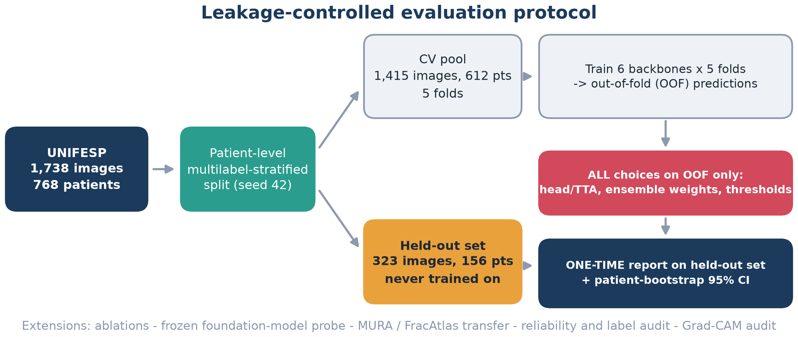
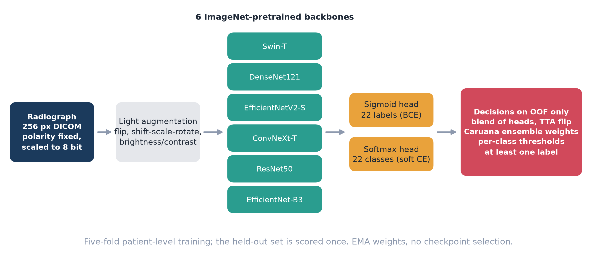
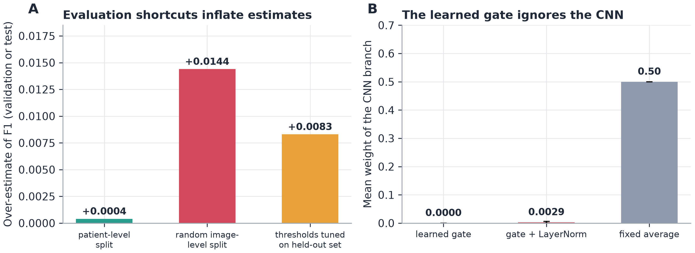
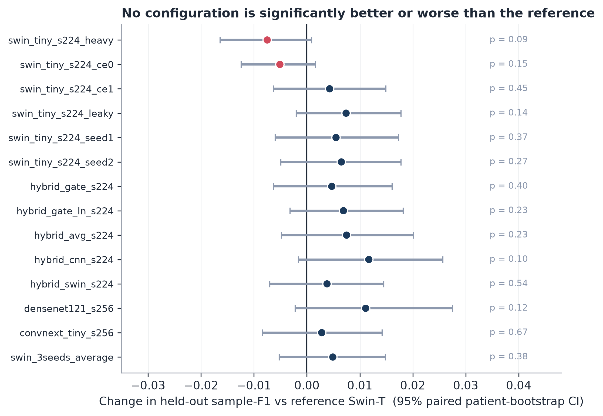
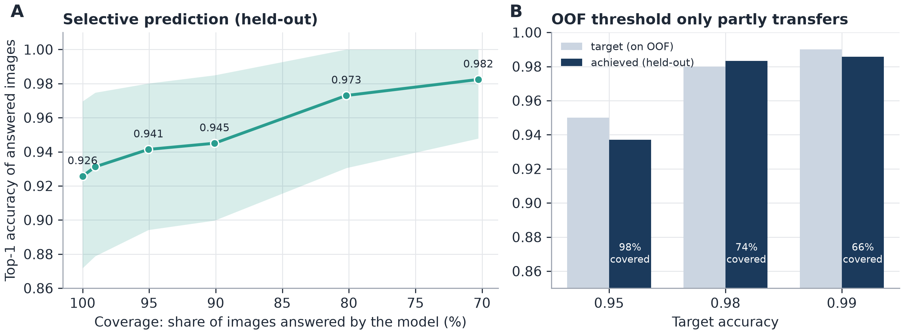
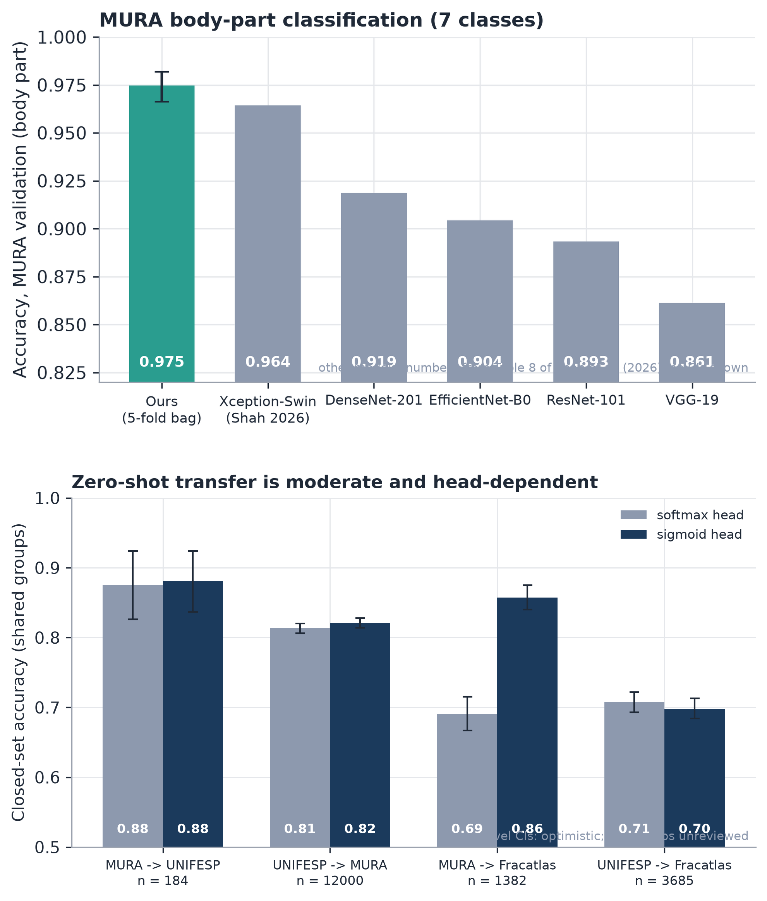
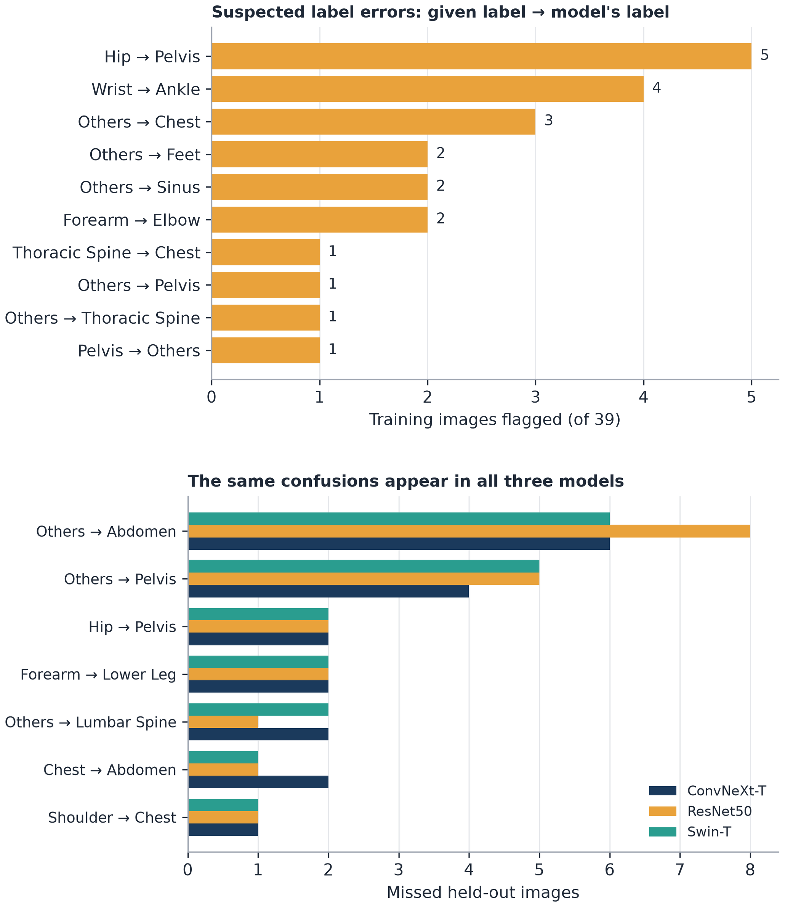

# Leakage-controlled benchmarking of radiograph body-part classification

**Reliability, label audit, explainability and cross-dataset transfer on public data.**

[](https://doi.org/10.5281/zenodo.24027438)


Sheikh Noor Abdullah ([ORCID 0009-0002-7193-4284](https://orcid.org/0009-0002-7193-4284)) and A.B.M. Kabir Hossain
Department of Information and Communication Engineering, Bangladesh Army University of Engineering & Technology (BAUET), Natore, Bangladesh.
Funding: none. Status: manuscript under preparation for journal submission.

> **This repository makes no state-of-the-art claim.** What it offers is a transparent evaluation protocol, honest negative results, and tools for judging whether a body-part classifier can be trusted in a routing role.

<p align="center">
  
</p>

---

## Contents
1. [The question](#the-question)
2. [Main findings](#main-findings)
3. [Figures](#figures)
4. [Repository layout](#repository-layout)
5. [Data (not included)](#data-not-included)
6. [Reproduce](#reproduce)
7. [Notebooks](#notebooks)
8. [Honest limitations](#honest-limitations)
9. [Cite](#cite)
10. [Licence and responsible use](#licence-and-responsible-use)

## The question
Published accuracies for radiograph body-part classification are hard to compare. Splits, thresholds and uncertainty are rarely described, and most large studies use private data. Two shortcuts are known to inflate results in other fields: leakage between images of the same patient, and thresholds or checkpoints chosen on the data that is later scored. We did not find a measurement of how large these effects are for body-part classification, so we measured them, on public data, under a protocol that rules them out:

* **Patient-level, multilabel-stratified split** of the UNIFESP body-part dataset (22 classes, 1,738 labelled radiographs, 768 patients): a fixed held-out set of 323 images / 156 patients and a cross-validation pool of 1,415 images / 612 patients in five folds.
* **Every decision on out-of-fold (OOF) predictions only**: head and test-time-augmentation variant, ensemble weights (Caruana selection), per-class thresholds, the minimum-one-label rule. The held-out set is scored once.
* **Patient-cluster bootstrap** confidence intervals and paired patient-bootstrap tests for every comparison.

## Main findings
All numbers come from files in [`results/`](results/); the full list with sources is in [`docs/PAPER_FACTS.md`](docs/PAPER_FACTS.md).

| Topic | Result |
|---|---|
| Held-out ensemble (UNIFESP) | sample-mean F1 **0.9189** [0.8669, 0.9602]; ensemble minus best single model +0.0066 [-0.0002, +0.0142], p = 0.063 |
| Ablations (augmentation, loss, backbone, seed, fusion, split type) | no configuration significantly better or worse than the reference (all p > 0.08); seed-to-seed spread is as large as most effects |
| Evaluation shortcuts | a random image-level split over-estimates validation F1 by **0.0144** (patient-level folds: 0.0004); tuning thresholds on the scored set adds **+0.0083** |
| CNN-Transformer gated fusion | the learned gate gives the CNN branch a weight of 0.0000 / 0.0029: it collapses onto the Transformer |
| Frozen DINOv2-S linear probe | held-out 0.8859 [0.8327, 0.9318], still improving with more labelled data |
| MURA body part (official validation split, 3,197 images) | accuracy 0.9747 [0.9663, 0.9818], macro-F1 0.9707; the one published figure we found for this task is 0.9643 / 0.9574 (Shah et al., 2026) |
| Zero-shot transfer through an explicit class map | 0.69 to 0.88 depending on pair and head (image-level CIs, optimistic) |
| Reliability | ECE 0.0545 (already calibrated; temperature scaling barely helps); 94.5 % accuracy on the 90 % of images kept at 90 % coverage |
| Label audit | 39 of 1,415 training images (2.8 %) flagged as suspected label errors; **not reviewed by a clinician** |
| Kaggle (late submissions, unranked) | private 0.92563 (Stage 1) and 0.92638 (Stage 2); between 2nd (0.92787) and 3rd (0.92488); first place is 0.93378; one private score has a standard error of about 0.012 |
| Stage 2 (OOF on all 1,738 images) | plain 0.9262, pseudo-labelled 0.9233, union 0.9279; differences not significant |

**Take-away:** how a classifier is evaluated mattered more than its architecture. Gains from fusion, ensembling and pseudo-labelling stayed within the noise of a 323-image held-out set.

## Figures
<table>
<tr>
<td width="50%"><br><sub><b>Models and decision pipeline.</b> Six backbones, sigmoid and softmax heads, five patient-level folds.</sub></td>
<td width="50%"><br><sub><b>Shortcuts and the gate.</b> Leaky split and held-out tuning inflate scores; the gate ignores the CNN.</sub></td>
</tr>
<tr>
<td><br><sub><b>Ablations.</b> No interval excludes zero.</sub></td>
<td><br><sub><b>Selective prediction.</b> Accuracy against coverage, and how OOF-chosen targets transfer.</sub></td>
</tr>
<tr>
<td><br><sub><b>MURA and zero-shot transfer.</b> Charts only; no MURA images are redistributed.</sub></td>
<td><br><sub><b>Label audit and confusions.</b> Suspected errors are suspects, not proven errors.</sub></td>
</tr>
</table>

## Repository layout
| Path | Content |
|---|---|
| `v2/src/` | all Python modules: data, training, ensembling, evaluation, ablation report, transfer, probe, reliability, Grad-CAM |
| `v2/*.ipynb`, `v2/build_*.py`, `v2/test_*.py` | Kaggle notebooks (generated from `v2/src`), their builders, and unit tests |
| `notebooks/ready_to_run/` | the final reusable Kaggle notebooks (see [`notebooks/README.md`](notebooks/README.md)); `notebooks/earlier/` keeps the provenance |
| `evalkit.py`, `eda.py`, `stage2_ci.py`, `test_evalkit.py` | evaluation toolkit, dataset EDA, Stage 2 bootstrap CIs |
| `make_paper_tables.py`, `make_figures.py`, `make_figures_extra.py`, `make_side.py` | tables and figures from the result files |
| `make_latex.py`, `make_bib.py`, `build_docx.py`, `figlib.py`, `trim.py` | manuscript builders (LaTeX with automatic figure numbering, Word) |
| `results/` | printed outputs and CSVs of the Kaggle runs; `results/kaggle_raw/` holds files downloaded from the public notebooks |
| `figures/`, `latex/`, `submission/` | paper figures (PNG), Elsevier-style LaTeX source, cover letter, highlights, title page |
| `Figures_for_upload/` | the 13 manuscript figures as separate PNG files with `captions.txt`, ready for journal upload |
| `docs/` | verified citations, dataset provenance and licence checks, the table of every number used in the paper, runbook; `docs/working_notes/` (novelty, journal shortlist, claim checklist) and `docs/drafts/` (earlier manuscript versions) |
| `MANUSCRIPT_v2.md` | working manuscript text that the builders read |

## Data (not included)
| Dataset | Source | Terms |
|---|---|---|
| UNIFESP X-Ray Body Part Classification | <https://www.kaggle.com/datasets/felipekitamura/unifesp-xray-bodypart-classification> (doi:10.34740/KAGGLE/DSV/3399135) | CC BY-NC-SA 4.0 |
| MURA v1.0 | Stanford AIMI, <https://stanford.redivis.com/datasets/cv1a-apytk3j44> | access request and the Stanford Dataset Research Use Agreement (non-commercial, **no redistribution**) |
| COVID-19 Radiography Database | <https://www.kaggle.com/datasets/tawsifurrahman/covid19-radiography-database> | files belong to their original authors |
| FracAtlas | doi:10.6084/m9.figshare.22363012 | CC BY 4.0 |

**Never commit MURA images, crops or embeddings to this repository.** The MURA experiments used a third-party Kaggle copy obtained before the official access was granted; its file names, sizes and MD5 hashes were later compared with the official index and found identical. Details and caveats (mirrors, version differences) are in [`docs/DATASET_CHECKS.md`](docs/DATASET_CHECKS.md).

## Reproduce
```bash
pip install -r requirements.txt

# 1. Build the index and the patient-level splits (inside v2/, with UNIFESP_DATA_ROOT set)
python -m src.build_index
python -m src.make_splits
python -m src.make_holdout_cv_splits --holdout_fold 4

# 2. Train, ensemble, transfer, probe, audit: run the notebooks (see docs/RUNBOOK.md)

# 3. Rebuild tables, figures and the manuscript from the result files
python make_paper_tables.py --root results --out results/paper_tables.md
python make_figures.py && python make_figures_extra.py && python make_side.py
python make_latex.py && python make_bib.py && python build_docx.py
```
Split fingerprints (SHA-256): `index.csv` `04cc621c95e8a353a665c4a2014b16045a4c6a14af0b944ca9ca9a4ad68a4b8a`, `splits/folds.csv` `ff44019bf2799d906acbbbe4d8e48f1228f244095a21e768ff9a74a64f36f36a`.
Unit tests: `pytest v2 test_evalkit.py`.

## Notebooks
Every analysis in the paper has a self-contained Kaggle notebook in [`notebooks/ready_to_run/`](notebooks/ready_to_run/): cross-dataset transfer (MURA, COVID-19, FracAtlas), the MURA official-split benchmark, the frozen foundation-model probe, reliability and the label audit, Grad-CAM explainability, and Stage 2. Each prints the numbers quoted in the paper. See [`notebooks/README.md`](notebooks/README.md) for the inputs each notebook needs.

## Honest limitations
* Single-centre data; the 323-image held-out set has only 1 to 6 positives for several classes, so per-class numbers are unstable.
* The COVID-19 and FracAtlas results use image-level splits and image-level intervals, which are optimistic.
* The class maps used for transfer, and the label-audit suspects, have not been reviewed by a clinician.
* Stage 2 pseudo-labelling uses unlabelled test images (a transductive step), and its ensemble weights are fitted on the same OOF predictions.
* Runs came from several Kaggle accounts; the package versions of the Kaggle image were not fully recorded (only PyTorch 2.11.0 is confirmed).
* Model weights are not included. The MURA experiments used a third-party Kaggle copy.

## Cite
Please cite the software release and, once published, the paper (see [`CITATION.cff`](CITATION.cff)):

```bibtex
@software{abdullah2026unifesp,
  author  = {Abdullah, Sheikh Noor and Hossain, A.B.M. Kabir},
  title   = {unifesp-bodypart-benchmark},
  year    = {2026},
  doi     = {10.5281/zenodo.24027438},
  url     = {https://github.com/NoorAbdullah02/unifesp-bodypart-benchmark}
}
```

## Licence and responsible use
Code: MIT (see [`LICENSE`](LICENSE)). Datasets and derived result files keep their own terms. This work is research code: the models are **not** a medical device and must not be used for clinical decisions. Any routing use would need local validation first.
